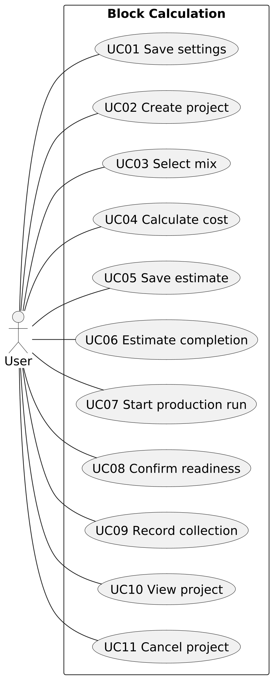
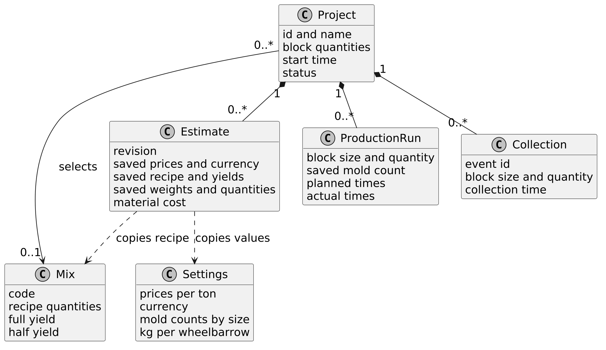
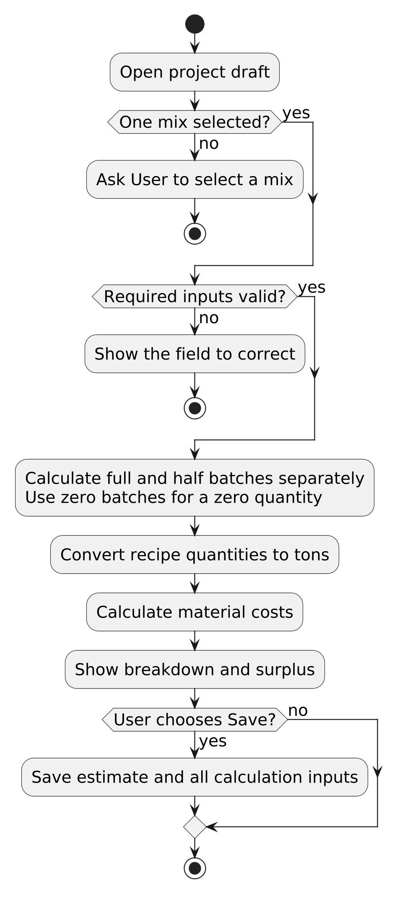
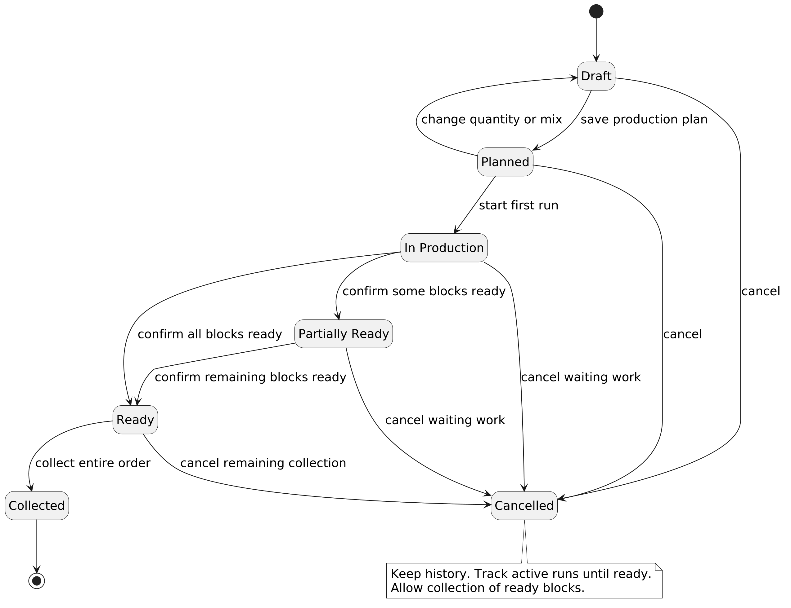
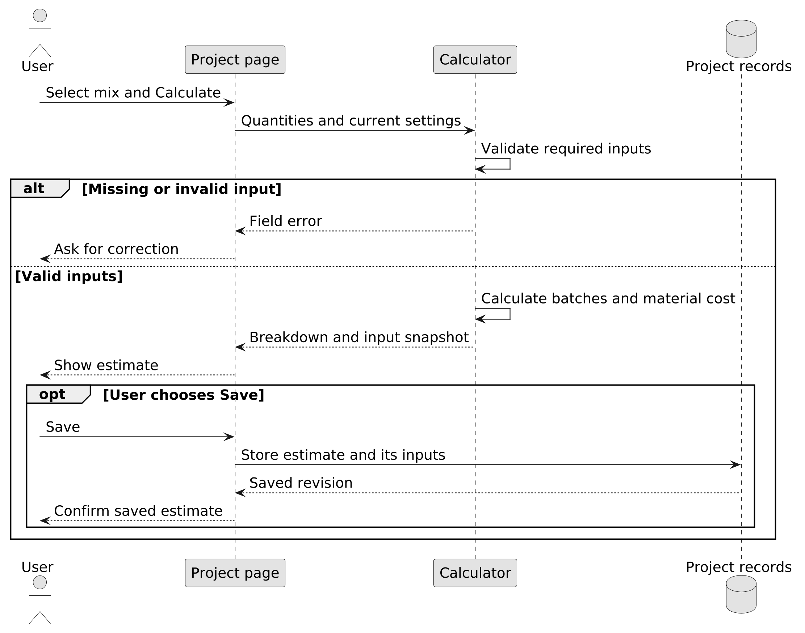
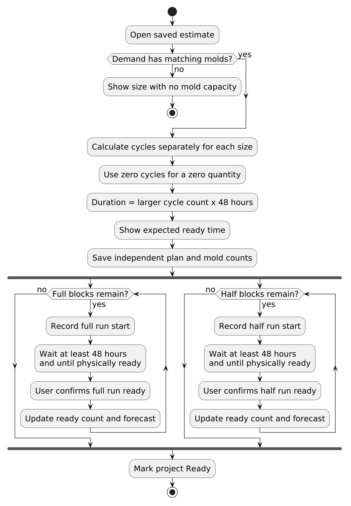

# Block Calculation — Vision and Scope (Project Study)

> Markdown version of [`Block-Calculation-Complete-Study.docx`](Block-Calculation-Complete-Study.docx), version 0.3 for customer review, 2 November 2026.
> Prepared by Mohamad Nour Shahin and Ali Hamdan (Almo Team). **The docx is the authoritative source**; this file exists so the study can be read, linked and diffed on GitHub.
> Traceability from requirements to issues and code: [traceability.md](traceability.md).

| Version | Date | Reason for changes |
|---|---|---|
| 0.1 | 28 Oct 2026 | Prepared the initial project study and diagrams |
| 0.2 | 1 Nov 2026 | Reviewed and simplified the study |
| 0.3 | 2 Nov 2026 | Applied instructor feedback and combined the study with UML images |

## 1 Business Requirements

Block Calculation will help a production planner estimate material costs and completion times, then track each project through production and collection. This document defines the first release for customer review before development.

### 1.1 Background

The planner currently calculates materials, costs, and mold cycles manually. Each order can contain full and half blocks. Material prices and the chosen mix affect the estimate, while the available molds determine how long production takes.

### 1.2 Business Opportunity

One application can bring these calculations and project records together. The planner can compare a new order with available production capacity and refer back to the prices used in an earlier estimate.

### 1.3 Business Objectives

| ID | Business objective | Description |
|---|---|---|
| BO01 | Prepare correct estimates | Use the selected mix, separate block yields, and current material prices. |
| BO02 | Plan production | Show the expected ready time from full and half mold counts. |
| BO03 | Keep reliable project records | Retain saved costs, actual production progress, and collected quantities. |
| BO04 | Make daily work easier | Keep settings and project tasks simple for a planner with basic browser skills. |

### 1.4 Success Metrics

| Objective | Acceptance measure |
|---|---|
| BO01 | All agreed calculation examples shall return the expected batch counts and costs. |
| BO02 | Each run shall fit the saved mold count for its block size. |
| BO03 | Price changes shall leave saved estimates unchanged; collection shall never exceed ready quantities. |
| BO04 | At least four of five first-time users shall create and save an estimate using one page of instructions, without assistance. |

### 1.5 Vision Statement

Give the planner one clear record of what each project will cost, when its blocks are expected to be ready, and what has been produced and collected.

### 1.6 Business Risks

| Risk | Impact | Response |
|---|---|---|
| Incorrect material weights or yields | High | Use measured weights and separate full and half yields for every mix. |
| Two projects assume the same molds are available | High | Label each forecast as independent. The planner coordinates actual mold use. |
| Settings changes alter earlier figures | High | Save the prices and calculation inputs with each estimate. |

### 1.7 Business Assumptions and Dependencies

The planner supplies material prices, measured kilograms per wheelbarrow, and the full and half yields for each mix. One mold makes one block in a 48-hour cycle that includes preparation and curing. Full and half mold pools can work in parallel. The customer confirms the production rules before development.

## 2 Scope and Limitations

### 2.1 Major Features

| ID | Feature | Business value |
|---|---|---|
| FE01 | Settings | Maintain material prices and production values. |
| FE02 | Projects and mix selection | Record the order and choose its recipe. |
| FE03 | Material estimates | Show required materials and their costs. |
| FE04 | Completion estimates | Plan time using the available molds. |
| FE05 | Production and collection | Track actual ready and collected blocks. |
| FE06 | Project records | Find projects and review their saved figures. |

### 2.2 Scope of Initial Release

The first release has one User role and includes FE01 to FE06. It supports two block sizes and four mix options. The estimate covers materials only.

| Block type | Length by width by height | Mold cycle |
|---|---|---|
| Full | 400 × 200 × 200 mm | 48 hours |
| Half | 200 × 200 × 200 mm | 48 hours |

The User shall choose one mix before calculating cost. Each mix has a separate yield for full blocks and half blocks. Every project keeps its own saved estimate and an independent completion forecast.

### 2.3 Scope of Subsequent Releases

Separate approval roles, accountant approvals, offline editing, and analytics may be considered later. They are outside the first release.

### 2.4 Limitations and Exclusions

The system does not include labor, transport, profit, payments, purchasing, stock control, machine control, or automatic currency conversion. It does not reserve molds across projects. Workers prepare materials and confirm physical readiness; the software records their progress.

## 3 Business Context

### 3.1 Stakeholder Profiles

| Stakeholder | Major Value | Attitudes | Major Interests | Constraints |
|---|---|---|---|---|
| Customer | Clear costs and delivery plans | Expects clear figures | Scope and calculation rules | Agrees rules before development |
| User | Less manual calculation | Needs simple screens | Estimates and progress | Enters actual production events |
| Almo Team | Agreed development scope | Supports a small first release | Requirements and testing | Mohamad Nour Shahin and Ali Hamdan |
| Instructor | A clear project study | Expects template fit | Requirements and UML | Academic review before development |

### 3.2 Project Priorities

| Dimension | Driver | Constraint | Degree of Freedom |
|---|---|---|---|
| Schedule | Review before development | Dates agreed with the customer | Agree milestone dates |
| Features | Complete the estimate and tracking workflow | One User role in the first release | Defer extra features |
| Quality | Correct costs and reliable records | Pass the agreed acceptance checks | Adjust screen details |
| Staff | Almo Team prepares and develops the project | Two named team members | Share development tasks |
| Cost | Keep the first release small | Budget agreed before development | Defer optional work |

### 3.3 Deployment Considerations

The application will run in a web browser on desktop and phone screens. The User needs a network connection. Before release, the team and customer agree supported browser versions, backup arrangements, and record retention. During onboarding, the User learns to configure Settings, calculate estimates, and record production and collection.

## 4 Functional Requirements

Each row describes one system function. These requirements define the first release. FR numbers identify requirements within this combined document.

| ID | Function | Requirement |
|---|---|---|
| FR01 | Material prices | The system shall save sand, 13 mm stone, and cement prices per metric ton. |
| FR02 | Currency | The system shall save the selected currency, with RUB as the default. |
| FR03 | Mold counts | The system shall save separate mold counts for full and half blocks. |
| FR04 | Mix yields | The system shall save a separate full-block yield and half-block yield for each mix. |
| FR05 | Material weights | The system shall save measured sand and stone weights in kilograms per wheelbarrow. |
| FR06 | Settings validation | The system shall reject invalid settings according to the rules in section 8. |
| FR07 | Create a project | The system shall save a project draft with its name, start time, and full and half quantities. |
| FR08 | Edit a draft | The system shall clear the unsaved estimate and production plan when draft quantities or the mix change. |
| FR09 | Select a mix | The system shall let the User select one of Mix 1, Mix 2, Mix 3, and Mix 4. |
| FR10 | Require a mix | The system shall block cost calculation until one mix is selected. |
| FR11 | Material quantities | The system shall calculate materials using separate full and half batch counts. |
| FR12 | Material cost | The system shall calculate total material cost from required tons and the prices used for that estimate. |
| FR13 | Estimate breakdown | The system shall display each material quantity, its cost, total cost, and mixing surplus. |
| FR14 | Missing inputs | The system shall block calculation and identify any missing required price, weight, or yield. |
| FR15 | Save an estimate | The system shall save the estimate with all inputs used in its calculation. |
| FR16 | Keep saved prices | The system shall keep saved estimate prices unchanged when Settings change. |
| FR17 | Estimate revisions | The system shall retain the previous estimate when the User saves a revised estimate. |
| FR18 | Lock an active order | The system shall lock block quantities and mix once production starts. |
| FR19 | Completion forecast | The system shall calculate the expected ready time using matching mold counts and 48-hour cycles. |
| FR20 | Missing mold capacity | The system shall refuse a completion forecast for a positive quantity with no matching molds. |
| FR21 | Independent forecast | The system shall show each project forecast independently, assuming its configured molds are available. |
| FR22 | Start a run | The system shall record a production run start without exceeding its saved mold count. |
| FR23 | Confirm readiness | The system shall update ready quantities when the User confirms a run is physically ready. |
| FR24 | Production delay | The system shall update the remaining forecast in that project when a run is delayed. |
| FR25 | Record collection | The system shall accept collection quantities only within the ready, uncollected balance for each size. |
| FR26 | Complete collection | The system shall mark a project Collected when its entire requested order has been collected. |
| FR27 | Project list | The system shall display projects with a status filter. |
| FR28 | Project summary | The system shall display the selected project’s estimate, production plan, actual progress, and collections. |
| FR29 | Cancel a project | The system shall cancel waiting work while retaining project history and tracking active runs until ready. |
| FR30 | History | The system shall record changes with their time and User identifier. |
| FR31 | Repeated events | The system shall count each production or collection event only once. |
| FR32 | Conflicting edits | The system shall prevent an edit from silently overwriting a newer saved change. |

## 5 Nonfunctional Requirements

The selected attributes below use the ISO/IEC 25010:2023 product quality model in the ISO/IEC 25000 SQuaRE series. The acceptance checks describe what matters for this application. The source is listed in section 10.3.

| ID | Quality attribute | Requirement | Acceptance check |
|---|---|---|---|
| NFR01 | Functional suitability | The system shall return the expected batch counts and material costs in the agreed examples. | Compare results with section 8. |
| NFR02 | Interaction capability | The system shall show units and field errors beside the related inputs. | Enter invalid prices and quantities. |
| NFR03 | Interaction capability | The system shall keep main actions usable by keyboard and on desktop and phone screens. | Check keyboard access and layouts at 360 px and 1280 px. |
| NFR04 | Reliability | The system shall keep the previous complete record if saving fails. | Interrupt a save and reopen the project. |
| NFR05 | Reliability | The system shall support restoring project records from the latest daily backup. | Restore the backup and compare saved records. |
| NFR07 | Maintainability | The calculation rules shall be testable separately from the screens. | Run tests for costs, timing, saved prices, and zero capacity. |
| NFR08 | Flexibility | The system shall support the complete workflow in the agreed desktop and phone browsers. | Check desktop Chrome, Firefox, and one agreed phone browser; record versions. |

Ease of use is checked through BO04.

## 6 Use Cases and Scenarios

The actor is the User. Each use case has one goal. A project is a saved order; a run is one group of blocks occupying molds.

| ID and goal | Main scenario | Requirements |
|---|---|---|
| UC01 Save settings | The User shall submit Settings. The system shall validate and save the values. | FR01–FR06 |
| UC02 Create project | The User shall enter a name, start time, and block quantities. The system shall save a valid draft. | FR07 |
| UC03 Select mix | The User shall choose one mix for a draft. The system shall store the selection. | FR08–FR10 |
| UC04 Calculate cost | The User shall request calculation for a valid draft. The system shall display its material estimate. | FR10–FR14 |
| UC05 Save estimate | The User shall save a displayed estimate. The system shall store that estimate and its inputs. | FR15–FR17 |
| UC06 Estimate completion | The User shall request a forecast for a saved estimate. The system shall show its expected ready time. | FR19–FR21 |
| UC07 Start production run | The User shall start a planned run. The system shall record its actual start time. | FR18, FR22 |
| UC08 Confirm readiness | The User shall confirm a started run is ready after at least 48 hours. The system shall update ready quantities. | FR23–FR24 |
| UC09 Record collection | The User shall submit a collection quantity. The system shall save it within the ready, uncollected balance. | FR25–FR26 |
| UC10 View project | The User shall select a project from the list. The system shall display its summary. | FR27–FR28 |
| UC11 Cancel project | The User shall confirm cancellation with a reason. The system shall stop waiting work and retain the record. | FR29–FR30 |

### 6.1 Alternative Scenarios

| ID | Use case | Required response |
|---|---|---|
| SC01 | UC04 | If no mix is selected, the system shall ask for a mix and show no cost. |
| SC02 | UC04 | If a required input is missing, the system shall identify the field and stop calculation. |
| SC03 | UC06 | If a required mold count is zero, the system shall identify the block size that cannot be timed. |
| SC04 | UC09 | If collection exceeds the ready balance, the system shall reject the collection. |
| SC05 | UC08 | If the run is not physically ready, the system shall keep it active and update the remaining forecast. |
| SC06 | UC11 | If the project is already Collected, the system shall reject cancellation. |

## 7 User Stories

These stories describe the User’s reason for each main feature. The requirement links show how each story will be delivered.

| ID | User story | Requirements |
|---|---|---|
| US01 | As a User, I want to save material prices and production settings so estimates match our setup. | FR01–FR06 |
| US02 | As a User, I want to enter full and half quantities so each project matches the order. | FR07–FR08 |
| US03 | As a User, I want to choose a mix so the estimate uses the intended recipe. | FR09–FR14 |
| US04 | As a User, I want saved estimates to keep their prices so I can rely on earlier figures. | FR15–FR17 |
| US05 | As a User, I want a completion forecast so I can plan production. | FR19–FR21 |
| US06 | As a User, I want to record run progress so the remaining forecast reflects actual work. | FR18, FR22–FR24 |
| US07 | As a User, I want to record partial collection so I know what remains on site. | FR25–FR26 |
| US08 | As a User, I want to view project summaries so I can check cost and progress. | FR27–FR28 |
| US09 | As a User, I want to cancel waiting work so an unwanted project stops while its history remains. | FR29–FR30 |

### 7.1 Feature Links

| Feature | Requirements | Business objective |
|---|---|---|
| FE01 Settings | FR01–FR06 | BO01, BO04 |
| FE02 Projects and mixes | FR07–FR10, FR18 | BO01, BO03 |
| FE03 Material estimates | FR11–FR17 | BO01, BO03 |
| FE04 Completion estimates | FR19–FR21, FR24 | BO02 |
| FE05 Production and collection | FR22–FR26, FR29 | BO02, BO03 |
| FE06 Project records | FR27–FR28, FR30–FR32 | BO03, BO04 |

## 8 Business Rules and Acceptance

### 8.1 Mix Recipes

Sand and stone are measured in wheelbarrows for each mixing batch. Cement is measured in 50 kg bags. All purchase prices are entered per metric ton.

| Mix | Sand wheelbarrows | Stone wheelbarrows | Cement bags |
|---|---|---|---|
| Mix 1 | 3 | 0 | 1 |
| Mix 2 | 3 | 2 | 1 |
| Mix 3 | 2.5 | 2.5 | 1 |
| Mix 4 | 2 | 2 | 1 |

Each mix shall have separate full and half yields. Two half blocks shall not be treated as one full block when calculating materials. One metric ton is 1000 kg.

### 8.2 Validation and Saved Records

Block quantities and mold counts shall be whole numbers of zero or more. A project shall contain at least one block. Its name shall contain 1 to 100 characters. Required yields shall be positive whole numbers; required material weights shall be positive. Prices shall not be negative. A zero price shall require confirmation.

Mix 1 shall not require stone inputs. A draft may have no mix but shall have no calculated cost. A saved revision shall keep its original prices unless the User explicitly chooses current prices and confirms recalculation. Changing the currency label shall not convert prices.

### 8.3 Material Calculations

| Result | Rule |
|---|---|
| Full batches | Round full quantity ÷ full yield up to a whole batch. |
| Half batches | Round half quantity ÷ half yield up to a whole batch. |
| Total batches | Full batches + half batches. |
| Sand or stone tons | Total batches × wheelbarrows per batch × measured kg per wheelbarrow ÷ 1000. |
| Cement tons | Total batches × cement bags per batch × 50 ÷ 1000. |
| Total cost | Sum of each material’s tons × price per ton. |

A zero quantity contributes zero batches without division. Round only the final cost to two decimal places. Whole-batch surplus shall be displayed but shall not increase the order or its collectable quantity. The customer confirms whole-batch rounding and leftover handling during agreement.

### 8.4 Production Rules

Cycles for each size = its quantity ÷ its mold count, rounded up. Duration = the larger cycle count × 48 hours. Expected ready time = start time + duration. A zero quantity contributes zero cycles without division. Positive demand with no matching molds cannot be timed.

Full and half molds shall work in parallel. Each run shall use no more molds than the saved count for its size. A run shall be confirmed ready only after at least 48 elapsed hours and a physical check. Delays shall change only that project’s remaining forecast. Saved material costs shall remain unchanged.

For each size, collected ≤ ready ≤ requested. Cancellation shall stop waiting runs; active runs shall remain tracked until ready. Ready blocks may still be collected from a cancelled project. Status values are Draft, Planned, In Production, Partially Ready, Ready, Collected, and Cancelled. Timestamps shall retain their timezone; changing the displayed timezone shall not change elapsed cycle hours.

### 8.5 Worked Examples

The following numbers are test inputs. Actual production weights and yields are entered in Settings.

| Example input | Value |
|---|---|
| Order and mix | 1700 full, 300 half; Mix 2 |
| Yields | 35 full or 60 half per mixing batch |
| Measured weights | Sand 100 kg; stone 120 kg per wheelbarrow |
| Prices | Sand 10, stone 20, cement 100 RUB per ton |
| Molds | 50 full molds and 15 half molds |

| Result | Expected value |
|---|---|
| Mixing batches | 49 full + 5 half = 54 batches; surplus 15 full and 0 half |
| Sand | 16.2 tons; 162.00 RUB |
| Stone | 12.96 tons; 259.20 RUB |
| Cement | 2.7 tons; 270.00 RUB |
| Total material cost | 691.20 RUB |
| Completion time | 34 full cycles and 20 half cycles; 1632 hours, or 68 days |

### 8.6 Acceptance Checks

| ID | Check | Expected result |
|---|---|---|
| AT01 | Invalid settings or quantities | The system shall reject negatives, fractions where counts are required, and an all-zero order. |
| AT02 | Calculate without a mix | The system shall show no cost and request a mix. |
| AT03 | Use the worked example | The system shall return 54 batches, 691.20 RUB, and 1632 hours. |
| AT04 | Use Mix 1 with yields 22 full and 40 half | With the example prices and sand weight, the system shall return 86 batches and 688.00 RUB. |
| AT05 | Change cement price to 120 RUB per ton | The saved estimate shall stay 691.20 RUB. A new identical project shall cost 745.20 RUB. |
| AT06 | Order 51 full blocks with 50 molds | The system shall estimate 96 hours. A positive order with no matching molds shall have no forecast. |
| AT07 | Create two one-block projects with one mold | Each independent forecast shall be 48 hours from its own start, assuming the mold is available. |
| AT08 | Confirm a run at hour 60 | A following run in that project shall finish at hour 108; other projects shall stay unchanged. |
| AT09 | Collect from 10 ready blocks with 4 collected | The system shall accept 6 and reject 7. |
| AT10 | Cancel with active and waiting runs | The system shall stop waiting runs and retain active runs and history. |
| AT11 | Repeat an event or submit a conflicting edit | The system shall avoid double counting and prevent a silent overwrite. |
| AT12 | Interrupt a save and restore a backup | The system shall retain a complete record and restore the backed-up project. |

## 9 UML Diagrams

### 9.1 Use Case Diagram

The User has one goal in each use case. Mix selection is required before cost calculation.

### 9.2 Class Diagram

Projects own estimates, production runs, and collections. An estimate keeps the settings and recipe values used in its calculation.

### 9.3 Estimate Activity Diagram

This diagram shows the normal calculation and save flow, including missing-input checks.

### 9.4 Project State Diagram

This diagram shows project status changes. Cancelling a project preserves its history and active run records.

### 9.5 Estimate Sequence Diagram

This diagram shows how a calculation request becomes a saved estimate.

### 9.6 Production Activity Diagram

Full and half mold pools work in parallel. Each run needs a physical readiness check. Delays update only this project; cancellation is shown in the state diagram.

## 10 Customer Agreement

### 10.1 Review Checklist

The customer and Almo Team shall review this document before development. They shall confirm the block dimensions, mix recipes, measured material weights, separate yields, mold counts, calculation examples, production rules, and collection rules.

They shall agree whole-batch rounding, leftover handling, browser support, backup arrangements, and record retention. Later changes shall record the reason and the affected requirements or diagrams.

### 10.2 Agreement Record

Document version: 0.3

Decision: Accept / Accept with amendments / Revise

Customer representative: __________________________

Signature and date: ______________________________

Almo Team representative: _________________________

Signature and date: ______________________________

Agreed amendments: ______________________________

________________________________________________

### 10.3 References

Vision and Scope Template supplied by the customer; prior project study and agreed customer answers; four mix recipes; Milestone 3.

ISO/IEC 25010:2023 Product quality model. ISO official standard page: https://www.iso.org/standard/78176.html
